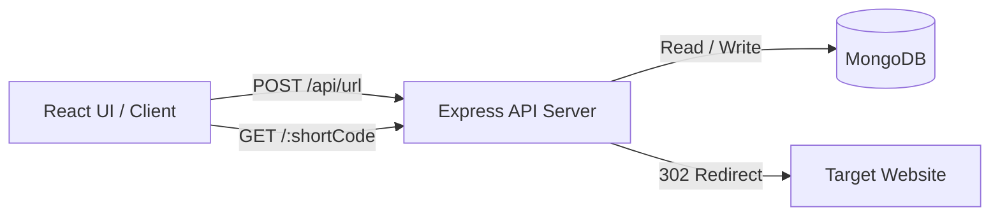

# 🔗 LinkShort - Modern Full-Stack URL Shortener

[](https://nodejs.org/)
[](https://expressjs.com/)
[](https://react.dev/)
[](https://tailwindcss.com/)
[](https://www.mongodb.com/)
[](https://github.com/)
[](https://opensource.org/licenses/MIT)

A high-performance, secure, and developer-friendly URL shortener built with Node.js, Express, MongoDB, React, Redux Toolkit, and Tailwind CSS. Features custom short aliases, click redirect tracking, local history, resilient error handling, and 40 automated unit & integration tests.

---

## 📑 Table of Contents

- [Features](#-features)
- [Architecture & Tech Stack](#-architecture--tech-stack)
- [Project Structure](#-project-structure)
- [Prerequisites](#-prerequisites)
- [Getting Started](#-getting-started)
- [Environment Variables](#-environment-variables)
- [Running the Application](#-running-the-application)
- [API Documentation](#-api-documentation)
- [Testing](#-testing)
- [GitHub Push Readiness Checklist](#-github-push-readiness-checklist)
- [License](#-license)

---

## ✨ Features

- ⚡ **Instant URL Shortening**: Automatically generates 7-character collision-resistant URL identifiers using Nanoid.
- 🏷️ **Custom Short Codes / Aliases**: Allows users to specify customized slugs (e.g. `/my-portfolio`) with format validation and collision detection.
- 📊 **Click & Redirect Tracking**: Automatically tracks redirect counts (`clicks`) with timestamps.
- 📈 **Stats API**: Dedicated endpoint (`GET /api/url/:shortCode/stats`) to retrieve analytics for any shortened link.
- 🛡️ **Security & Validation**:
  - Validates and sanitizes URLs (rejects malicious `javascript:`, `data:`, and `file:` URIs).
  - Normalizes URLs (supports URLs entered with or without `https://`).
  - Protects reserved routes (`api`, `health`, `favicon.ico`, etc.).
  - Configurable CORS whitelist.
- 💻 **Modern React UI**:
  - Built with React 19, Redux Toolkit, and Tailwind CSS v4.
  - Interactive URL history stored locally in browser `localStorage`.
  - Instant one-click copy to clipboard with live visual feedback.
  - Safe error handling and graceful fallbacks.
- 🩺 **Production Readiness**:
  - `/health` endpoint for Docker and cloud uptime monitors.
  - Graceful shutdown handling (`SIGINT`, `SIGTERM`).
  - 0 known npm security vulnerabilities.
- 🧪 **Comprehensive Automated Testing**: 40 unit and integration tests across backend and frontend.

---

## 🏗️ Architecture & Tech Stack



### Backend
- **Runtime**: Node.js (ES Modules)
- **Framework**: Express 5
- **Database ODM**: Mongoose 9
- **Identifier Generator**: Nanoid
- **Testing**: Node.js Native Test Runner (`node:test`) + Supertest

### Frontend
- **Framework**: React 19 + Vite 8
- **State Management**: Redux Toolkit (`@reduxjs/toolkit` + `react-redux`)
- **Styling**: Tailwind CSS v4
- **Testing**: Vitest
- **Linting**: ESLint 10

---

## 📁 Project Structure

```text
urlShortener/
├── backend/
│   ├── src/
│   │   ├── config/
│   │   │   └── db.js                 # MongoDB connection & disconnect handlers
│   │   ├── controllers/
│   │   │   └── url.controller.js     # HTTP request handlers (shorten, redirect, stats)
│   │   ├── dao/
│   │   │   └── url.dao.js            # Database access object (Mongoose queries)
│   │   ├── models/
│   │   │   └── url.model.js          # Mongoose Schema & Model with timestamps
│   │   ├── routes/
│   │   │   └── url.routes.js         # API and redirect routes
│   │   ├── services/
│   │   │   └── url.service.js        # Business logic, customCode validation & collision logic
│   │   ├── utils/
│   │   │   ├── errorHandler.js       # Centralized ApiError & Express error middleware
│   │   │   ├── generateShortCode.js  # Nanoid shortcode generator with retry guard
│   │   │   ├── tryCatch.js           # Async route handler wrapper
│   │   │   └── url.helpers.js        # URL validation and normalization helpers
│   │   └── app.js                    # Express app initialization, CORS, middlewares
│   ├── tests/
│   │   ├── api.test.js               # Supertest integration tests for all API endpoints
│   │   ├── errorHandler.test.js      # Unit tests for error handler & ApiError
│   │   └── url.helpers.test.js       # Unit tests for URL validation & normalization
│   ├── .env.example                  # Backend environment template
│   ├── package.json
│   └── server.js                     # HTTP server bootstrap & graceful shutdown
├── frontend/
│   ├── src/
│   │   ├── api/
│   │   │   ├── urlApi.js             # API client with fallback URL
│   │   │   └── urlApi.test.js        # API client unit tests
│   │   ├── components/
│   │   │   ├── layout/
│   │   │   │   ├── Header.jsx        # App header and live status badge
│   │   │   │   └── Footer.jsx        # Footer with navigation and copyright
│   │   │   ├── URLHistory.jsx        # Recent shortened URLs with copy & delete
│   │   │   ├── URLInput.jsx          # Shortener form with custom code input
│   │   │   └── URLResult.jsx         # Modal dialog showing generated short link
│   │   ├── store/
│   │   │   ├── store.js              # Redux Toolkit store configuration
│   │   │   ├── urlSlice.js           # URL history and result slice reducer
│   │   │   └── urlSlice.test.js      # Redux store unit tests
│   │   ├── App.jsx                   # Main React component
│   │   ├── index.css                 # Tailwind CSS entry
│   │   └── main.jsx                  # React DOM entry
│   ├── .env.example                  # Frontend environment template
│   ├── index.html
│   ├── package.json
│   └── vite.config.js
├── .gitignore                        # Global Git ignore (secrets, build, logs)
├── package.json                      # Monorepo root script runner
└── README.md                         # Project documentation
```

---

## ⚙️ Prerequisites

- **Node.js**: `v20.0.0` or higher (recommended: `v22.x`)
- **npm**: `v10.x` or higher
- **MongoDB**: A running MongoDB instance locally or a free [MongoDB Atlas](https://www.mongodb.com/atlas) cluster

---

## 🚀 Getting Started

### 1. Clone the repository
```bash
git clone https://github.com/<your-username>/<your-repo-name>.git
cd urlShortener
```

### 2. Install all dependencies
You can install dependencies for both frontend and backend using the root script:
```bash
npm run install:all
```
*(Or navigate to `backend` and `frontend` folders separately and run `npm install`)*

### 3. Configure environment variables

**Backend:**
Copy `.env.example` to `.env`:
```bash
cp backend/.env.example backend/.env
```
Update `backend/.env` with your MongoDB connection string:
```env
PORT=3000
NODE_ENV=development
MONGODB_URI=mongodb+srv://<username>:<password>@cluster0.example.mongodb.net/urlShortener
ALLOWED_ORIGINS=http://localhost:5173
```

**Frontend:**
Copy `.env.example` to `.env`:
```bash
cp frontend/.env.example frontend/.env
```
Ensure `VITE_API_BASE_URL` points to your backend URL:
```env
VITE_API_BASE_URL=http://localhost:3000/api/url
```

---

## 🔐 Environment Variables

### Backend (`backend/.env`)

| Variable | Description | Default | Required |
|---|---|---|---|
| `PORT` | Port for the Express server to listen on | `3000` | No |
| `NODE_ENV` | Environment mode (`development`, `production`, `test`) | `development` | No |
| `BASE_URL` | Canonical public base URL for short links (e.g. `https://sho.rt`) | Dynamic `req.protocol://host` | No |
| `MONGODB_URI` / `MONGODBURI` | Connection URI for MongoDB database | — | **Yes** |
| `MONGODB_MAX_POOL_SIZE` | Maximum database connection pool size | `50` | No |
| `ALLOWED_ORIGINS` | Comma-separated list of allowed frontend origins or `*` | `*` | No |

### Frontend (`frontend/.env`)

| Variable | Description | Default | Required |
|---|---|---|---|
| `VITE_API_BASE_URL` | Base endpoint for URL shortening requests | Dev: `http://localhost:3000/api/url`, Prod: `/api/url` | No |


---

## 🏃 Running the Application

### Running in Development Mode

You can run both servers in separate terminal tabs:

**Terminal 1 (Backend):**
```bash
npm run dev:backend
# Server runs at http://localhost:3000
```

**Terminal 2 (Frontend):**
```bash
npm run dev:frontend
# Vite dev server runs at http://localhost:5173
```

### Building for Production

```bash
# Build frontend
npm run build:frontend

# Start backend in production mode
npm start --prefix backend
```

---

## 📖 API Documentation

### 1. Health Check
Checks if the server is healthy and responding.

- **URL**: `/health`
- **Method**: `GET`
- **Response**: `200 OK`
```json
{
  "status": "ok",
  "service": "url-shortener-api",
  "timestamp": "2026-10-09T00:15:00.000Z"
}
```

---

### 2. Create Short URL
Shortens a URL, optionally with a custom short code alias.

- **URL**: `/api/url`
- **Method**: `POST`
- **Headers**: `Content-Type: application/json`
- **Body Parameters**:
  - `originalUrl` *(string, required)*: The target URL to shorten.
  - `customCode` *(string, optional)*: 3 to 30 alphanumeric characters (`-` and `_` allowed).

#### Request Examples:
**Auto-generated code:**
```json
{
  "originalUrl": "https://developer.mozilla.org/en-US/docs/Web/JavaScript"
}
```

**Custom alias:**
```json
{
  "originalUrl": "https://github.com/my-awesome-project",
  "customCode": "my-project"
}
```

#### Response (`201 Created`):
```json
{
  "success": true,
  "shortUrl": "http://localhost:3000/my-project",
  "shortCode": "my-project"
}
```

#### Error Responses:
- **`400 Bad Request`**: Missing URL, invalid URL format, or invalid/reserved custom code.
  ```json
  {
    "success": false,
    "message": "Custom code must be 3-30 characters long and contain only letters, numbers, hyphens, and underscores."
  }
  ```
- **`409 Conflict`**: Custom short code is already taken.
  ```json
  {
    "success": false,
    "message": "Custom short code is already in use. Please pick another."
  }
  ```

---

### 3. Redirect to Original URL
Resolves the short code, increments the click counter, and redirects the client.

- **URL**: `/:shortCode`
- **Method**: `GET`
- **Response**: `302 Found` with `Location` header pointing to original destination URL.
- **Error Response**: `404 Not Found` if short code doesn't exist.

---

### 4. Get URL Analytics / Stats
Fetches statistics for a shortened URL.

- **URL**: `/api/url/:shortCode/stats`
- **Method**: `GET`
- **Response (`200 OK`)**:
```json
{
  "success": true,
  "data": {
    "shortCode": "my-project",
    "originalUrl": "https://github.com/my-awesome-project",
    "clicks": 14,
    "createdAt": "2026-10-09T00:10:00.000Z",
    "updatedAt": "2026-10-09T00:25:00.000Z"
  }
}
```

---

## 🧪 Testing

The project includes **40 automated tests** (29 backend integration/unit tests + 11 frontend unit tests).

### Run all tests (Monorepo root):
```bash
npm test
```

### Run backend tests only:
```bash
npm run test:backend
# or: cd backend && npm test
```

### Run frontend tests only:
```bash
npm run test:frontend
# or: cd frontend && npm test
```

### Run frontend linting & production build validation:
```bash
npm run lint:frontend
npm run build:frontend
```

---

## 🛡️ GitHub Push Readiness Checklist

Before pushing to GitHub, verify that all security and quality checks pass:

- [x] **No Secrets Exposed**: `.env` files in both root, backend, and frontend are ignored via `.gitignore`.
- [x] **Example Environment Files Provided**: Both `backend/.env.example` and `frontend/.env.example` are committed.
- [x] **Clean Dependency Audit**: 0 vulnerabilities found (`npm audit` passes with 0 issues).
- [x] **Automated Tests Passing**: All 40 unit and integration tests pass cleanly.
- [x] **Lint & Production Build Verified**: Frontend ESLint and Vite production build pass without warnings.
- [x] **Root `.gitignore` Configured**: OS files, logs, `node_modules`, and build artifacts are properly excluded.
- [x] **Graceful Error Handling**: Database errors, duplicate keys, invalid inputs, and unhandled routes return structured JSON responses.

### Ready to Push Commands:

```bash
# 1. Stage all tracked and new files
git add .

# 2. Commit changes
git commit -m "feat: complete url shortener with tests, docs, and production fixes"

# 3. Add your remote (if not already set)
git remote add origin https://github.com/<your-username>/<your-repo-name>.git

# 4. Push to master or main
git branch -M main
git push -u origin main
```

---

## 📄 License

This project is licensed under the [MIT License](https://opensource.org/licenses/MIT).
